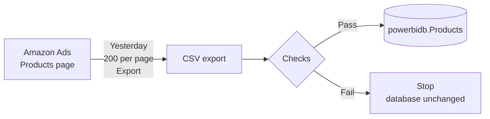

# Amazon Ads Products Report


This job exports the **Advertised products** report from Amazon Ads every day and loads it into the Power BI database (`powerbidb.Products`). Nobody needs to download or upload anything.

It replaces the manual `products_secondary_upload.py` process.

---

## Contents

1. [At a glance](#at-a-glance)
2. [How it works](#how-it-works)
3. [Server setup](#server-setup)
4. [Daily use](#daily-use)
5. [Checking that it works](#checking-that-it-works)
6. [Troubleshooting](#troubleshooting)
7. [Configuration](#configuration)
8. [Data rules](#data-rules)
9. [Reference](#reference)

---

## At a glance

| | |
| --- | --- |
| **Source** | Amazon Ads → Campaign Manager → **Products** → *Advertised products*, filtered on *Clicks: greater than 0* |
| **Destination** | MySQL table `powerbidb.Products` |
| **Schedule** | Every day at **2:00 PM IST**, loading **yesterday's** complete data |
| **Run time** | About 1–3 minutes |
| **Sign-in** | One OTP during setup. After that, every run uses the saved session. |
| **Safety** | Each day is replaced in a single transaction. If a run fails, the database doesn't change. |

---

## How it works



Each run does the same steps a person would do by hand:

1. **Checks the database.** It confirms the `Products` table is reachable and has the expected columns before it opens Amazon.
2. **Opens the Products page** with the saved Amazon session. You don't need to sign in or enter an OTP.
3. **Checks the filters.** The page must show **Clicks: greater than 0**. If someone left another filter on the page (for example *Orders: equals 0*), the run removes it automatically.
4. **Selects the date.** It picks **Yesterday** under *Date range* and confirms that the page shows the date it expects.
5. **Exports every product.** It sets *Results per page* to **200**, then clicks *Export* and the next-page arrow until every row has been downloaded.
6. **Validates the data.** It checks the columns, looks for repeated rows and confirms that the row count matches the page's *"of N results"*.
7. **Saves the data.** It deletes that date's old rows and inserts the new ones in **one transaction**.
8. **Keeps a copy.** The final CSV goes to `data/reports/` and a timestamped copy goes to `data/archive/`.

### Why 2 PM IST?

Amazon's *Today* and *Yesterday* follow **US Pacific time**. By 2 PM IST the US day has ended (at 12:30 PM IST, or 1:30 PM IST in US winter time), so the run loads complete and final numbers. Each row is stored under the **US date**, as the manual process did.

---

## Server setup

**Requirements:** a Linux server with Python 3.11 or newer, network access to MySQL and to Amazon, and a phone to receive the Amazon OTP once.

### Step 1: Get the code

```bash
git clone https://github.com/automationitrendsolution/Amazon-ad-products-report.git ~/Amazon_ad_products_report_cron
cd ~/Amazon_ad_products_report_cron
```

> Copying the folder instead? Leave out `.venv/` and `data/session/`. The server creates its own.

### Step 2: Install

```bash
curl -LsSf https://astral.sh/uv/install.sh | sh     # install uv (once per server)
uv sync --no-dev                                    # install Python packages
uv run playwright install --with-deps chromium      # install the browser
chmod +x scripts/*.sh
```

### Step 3: Configure

```bash
cp .env.example .env
chmod 600 .env
nano .env
```

Fill in the **MySQL login**, the **Amazon email and password**, and `AMAZON_ENTITY_ID`, which is the `entityId=ENTITY…` part of the Products page URL. Every option is explained inside `.env.example`.

> **Running as root?** Also set `BROWSER_NO_SANDBOX=true`.

### Step 4: Sign in to Amazon (one time)

```bash
uv run python run.py login
```

The job enters the email and password for you. When Amazon sends the **OTP** to the registered phone, type it into the terminal. The session is saved in `data/session/` and the browser is marked as trusted, so **scheduled runs won't ask for an OTP again**.

> **Sign in on the server itself.** A session saved on Windows doesn't work on Linux, because Chrome encrypts it per machine.

### Step 5: Do a test run

```bash
uv run python run.py yesterday --dry-run
```

The test run does everything except write to MySQL. It should finish with:

```text
status             : SUCCESS
```

### Step 6: Turn on the daily schedule

```bash
scripts/install_cron.sh --print    # checks the setup and shows the cron entry
scripts/install_cron.sh            # installs it
crontab -l                         # confirm it is there
```

The installer converts 2:00 PM IST to the server's own clock:

| Server timezone (check with `date`) | Cron expression |
| --- | --- |
| IST (`Asia/Kolkata`) | `0 14 * * *` |
| UTC (most cloud servers) | `30 8 * * *` |

The installed entry looks like this:

```cron
0 14 * * * /home/USER/Amazon_ad_products_report_cron/scripts/run_products_report.sh yesterday >> /home/USER/Amazon_ad_products_report_cron/logs/products_cron.log 2>&1
```

The installer adds or replaces only its own entry and leaves other cron jobs alone. If a run is still going when the next one starts, the new one is skipped instead of overlapping.

### Step 7: Retire the old process

Turn off `products_secondary_upload.py` so that only this job writes to `Products`.

**Setup is complete.** ✅

---

## Daily use

The job runs by itself. Use these commands only when you want to do something by hand:

| I want to… | Command | Writes to the database? |
| --- | --- | --- |
| Load yesterday's data now | `uv run python run.py yesterday` | ✅ Yes |
| Load today's data (partial day) | `uv run python run.py today` | ✅ Yes |
| Test without saving | `uv run python run.py yesterday --dry-run` | ❌ No |
| Sign in to Amazon again (OTP) | `uv run python run.py login` | ❌ No |
| Run the automated tests | `uv run python -m pytest` | ❌ No |

> Running the same day twice is safe. The second run replaces the first; it doesn't add duplicates.

---

## Checking that it works

### Logs

```bash
tail logs/products_cron.log      # one START and one END line per run
tail -n 30 logs/products_report.log   # full details of the last run
```

A successful run ends with a summary like this:

```text
Run summary (yesterday)
  duration           : 87.0s
  date range         : Yesterday = 2026-10-29
  exported           : 1 page(s), 479 product row(s) (page shows 479)
  Products           : 0 deleted, 479 inserted for 2026-10-29
  status             : SUCCESS
```

### Database

```sql
SELECT Date, COUNT(*) AS products, SUM(Orders) AS orders, ROUND(SUM(`Sales(USD)`), 2) AS sales
FROM powerbidb.Products
GROUP BY Date
ORDER BY Date DESC
LIMIT 7;
```

Each day's row count should match the *"of N results"* that the Products page shows for that date.

---

## Troubleshooting

| What you see | What it means | What to do |
| --- | --- | --- |
| Exit code **3** / `AuthenticationError` | Amazon wants a new OTP. This is rare, roughly once a year. | Run `uv run python run.py login` on the server and enter the OTP. |
| `does not show the filter 'Clicks: greater than 0'` | The required filter was removed from the page. | Add it back once in a normal browser (Amazon remembers it), or change `REQUIRED_FILTER_TEXT`. |
| `Could not find '<name>'` | Amazon changed a button on the page. | Look at the screenshot in `data/screenshots/` and add a working selector at the top of that entry in `config/selectors.json`. No code change is needed. |
| `The Date range shows …, expected …` | The page didn't switch to the right day. | Nothing was saved. Run it again; check the screenshot if it keeps happening. |
| `is missing column(s)` | A column is hidden on the Products page. | Products page → **Columns** → turn the column back on. |
| `exports hold X row(s) … but the page shows N` | A page hadn't finished loading. | The job retries automatically. If it keeps happening, increase `BROWSER_TIMEOUT_MS`. |
| `SKIPPED` / exit code **11** | The previous run was still running. | Nothing, unless it happens every day. |

Whenever a browser step fails, a screenshot is saved to `data/screenshots/`. Exports that fail the checks are kept in `data/failed/`.

---

## Configuration

All settings are in `.env`. Copy them from `.env.example`, which explains each one. The most important ones:

| Setting | Purpose |
| --- | --- |
| `DB_HOST`, `DB_PORT`, `DB_USER`, `DB_PASSWORD` | MySQL login. `DB_NAME` must be `powerbidb`. |
| `AMAZON_ENTITY_ID` | The advertiser account: the `entityId=ENTITY…` part of the Products page URL. |
| `AMAZON_EMAIL`, `AMAZON_PASSWORD` | Used by `login`, and to sign in again automatically if the session expires. |
| `AMAZON_ACCOUNT_TIMEZONE` | Amazon's reporting timezone: `America/Los_Angeles` for US accounts. |
| `REQUIRED_FILTER_TEXT` | The filter the page must show (default: `Clicks: greater than 0`). Leave it empty to skip the check. |
| `RESULTS_PER_PAGE` | `25`, `50`, `100` or `200` (default: `200`). |
| `HEADLESS` | Keep `true` on the server. |
| `BROWSER_NO_SANDBOX` | Set to `true` when the job runs as root. |

To change the schedule time, reinstall the cron entry with a different time:

```bash
CRON_YESTERDAY_TIME="15:00" scripts/install_cron.sh
```

> 🔒 **Security:** `.env` and `data/session/` contain credentials. They are excluded from git, and `.env` must stay readable only by its owner (`chmod 600 .env`).

---

## Data rules

| Rule | Detail |
| --- | --- |
| **Columns stored** | `Date`, `Products`, `Status`, `Type`, `Sponsored Products eligibility`, `Sales(USD)`, `Impressions`, `Clicks`, `Spend(USD)`, `Orders`, `NTB orders`, `NTB sales(USD)` |
| **Columns skipped** | Export columns that the table doesn't have (for example `Conversion rate`) are logged and left out. |
| **Date** | The US Pacific date of the report day, for example `2026-10-29`. |
| **Numbers** | Converted to plain numbers: `$2,861.76` → `2861.76`, `9.71%` → `9.71`. |
| **Replace** | `DELETE` that date, then `INSERT` the new rows, in one transaction. |
| **Empty days** | If the page shows 0 results, the existing rows for that date are kept. |

**Improvements over the manual script:**

- **No partial days.** The row count must match the page's total, or nothing is saved.
- **No wrong dates.** The date shown on the page is checked before export.
- **No wrong filters.** Extra filters left on the page are removed automatically.

---

## Reference

<details>
<summary><b>Exit codes</b></summary>

| Code | Meaning |
| --- | --- |
| 0 | Success |
| 2 | Configuration problem (a `.env` value is missing or wrong) |
| 3 | Amazon sign-in needed: run `python run.py login` |
| 4 | The page didn't load or a button wasn't found (after retries) |
| 5 | The page wasn't set up as expected (required filter missing) |
| 6 | Export download failed (after retries) |
| 7 | The export file isn't valid (missing columns or repeated rows) |
| 8 | A value doesn't fit its number column |
| 9 | Database problem (rolled back, nothing changed) |
| 11 | The previous run was still in progress (skipped) |
| 14 | The page showed a different date than expected |
| 15 | The export didn't match the page's result count (after retries) |

</details>

<details>
<summary><b>Project structure</b></summary>

```text
run.py                      Entry point: today | yesterday | login
app/
  main.py                   Runs the steps and prints the summary
  products_page.py          Products page: filters, date range, 200 per page, export
  products_csv.py           Reads, checks and merges the exports
  database.py               MySQL checks and the single transaction
  periods.py                Today / Yesterday → US date
  browser.py, auth.py       Browser session and Amazon sign-in
  config.py                 Reads .env
config/
  selectors.json            How the job finds buttons on Amazon's pages
scripts/
  install_cron.sh           Checks the server and installs the daily cron entry
  run_products_report.sh    Cron wrapper: lock, paths, exit status
data/
  reports/                  Latest export (Products_yesterday.csv / Products_today.csv)
  archive/                  Timestamped copies of past exports
  failed/                   Exports that failed the checks
  session/                  Saved Amazon sign-in (treat it like a password)
  screenshots/              Screenshots of failed browser steps
logs/                       products_report.log, products_cron.log
tests/                      Automated tests (need neither Amazon nor MySQL)
```

</details>
