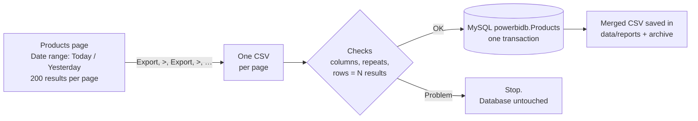

# Amazon Ads Products Page → Power BI


This job exports the **Products** page (Advertised products) from Amazon Ads Campaign Manager and loads it into `powerbidb.Products`. Cron runs it once a day at **2 PM IST** for the completed previous day (Yesterday). Nobody needs to click through the pages or upload a CSV.

It replaces the manual `products_secondary_upload.py` script. It writes the same table and the same twelve columns, and every load is checked and saved safely.

---

## Contents

- [At a glance](#at-a-glance)
- [How it works](#how-it-works)
- [When it runs](#when-it-runs)
- [Setup on a Linux server](#setup-on-a-linux-server)
- [First run: check the page controls](#first-run-check-the-page-controls)
- [Everyday commands](#everyday-commands)
- [Checking that it works](#checking-that-it-works)
- [Troubleshooting](#troubleshooting)
- [Configuration](#configuration)
- [Data rules](#data-rules)
- [Reference](#reference)

---

## At a glance

| | |
| --- | --- |
| **Source** | Amazon Ads → Campaign Manager → **Products** → Advertised products (filter *Clicks: greater than 0*) |
| **Destination** | MySQL `powerbidb.Products` |
| **Schedule** | **Yesterday** daily at **14:00 IST** (`python run.py yesterday`). **Today** can be run by hand. |
| **Run time** | About 2–5 minutes per run |
| **Safety** | Each date is replaced in **one transaction**. An incomplete or failed run changes nothing. |

---

## How it works



Each run does the steps you used to do by hand:

1. **Checks first.** Confirms the `Products` table has every column before opening Amazon.
2. **Opens the Products page** (`cm/products?entityId=…`, Advertised products tab) and checks that the filter **Clicks: greater than 0** is applied.
3. **Date range → Today** (or **Yesterday**) **→ Apply**, then checks that the button shows the expected date (e.g. `Date range: Oct 28, 2026`).
4. **Results per page → 200.**
5. **Export → next page (>) → Export → …** until the footer `x–y of N results` reaches N.
6. **Validates.** Every page export has the twelve required columns, no row appears on two pages, and the merged rows equal **N**.
7. **Saves to MySQL.** Deletes that date's rows and inserts the new ones in **one transaction**. If anything goes wrong, nothing is changed.
8. **Keeps the files.** The merged CSV goes to `data/reports/Products_today.csv` (or `Products_yesterday.csv`), and the page exports go to `data/archive/`.

---

## When it runs

Amazon's **Today** and **Yesterday** follow **US time** (Los Angeles). A US day runs from **12:30 PM IST to 12:30 PM IST the next day** (1:30 PM in US winter time). The job stores each load under the US date, exactly as the old script did with `US/Pacific`.

| Command | Date saved |
| --- | --- |
| `python run.py yesterday` (cron, **14:00 IST**) | the US day that ended at 12:30 PM IST: **final, complete numbers** |
| `python run.py today` (by hand) | the US day in progress (partial numbers) |

> **Why Yesterday at 2 PM.** By 2 PM IST the US day has ended (even in US winter time), so the run loads that date's complete numbers.

---

## Setup on a Linux server

**You need:** Linux with Python 3.11+, network access to MySQL and Amazon, and an Amazon Ads login with access to the account.

### 1. Copy and install

```bash
cd ~/Amazon_ad_products_report_cron
curl -LsSf https://astral.sh/uv/install.sh | sh     # install uv (once per server)
uv sync --no-dev                                    # create .venv from uv.lock
uv run playwright install --with-deps chromium      # install the browser
chmod +x scripts/*.sh
```

> Copy the project **without** `.venv/` and `data/session/`. Both are created on the server.

### 2. Configure

```bash
cp .env.example .env && chmod 600 .env     # then fill in the values
```

Fill in at least the database login, `AMAZON_ENTITY_ID` (the `entityId=ENTITY…` value in the Products page URL) and the Amazon login. See [Configuration](#configuration).

> Running as **root**? Add `BROWSER_NO_SANDBOX=true` to `.env`.

### 3. Sign in to Amazon once

```bash
uv run python run.py login
```

The job fills in the email and password from `.env`. When Amazon asks for the **verification code (OTP)**, type it in the terminal. It ticks *"Don't require OTP on this browser"*, and the session is saved in `data/session/`. Every scheduled run reuses it, so **cron never asks for an OTP**. If the session lapses, the run signs in again with the email and password.

> Do this **on the server**. A browser session saved on Windows can't be copied to Linux (Chrome encrypts it per machine).

> This project has its **own** session folder. Don't point `SESSION_DIR` at the targeting report's session: two jobs can't open the same browser profile at the same time.

### 4. Test without writing to the database

```bash
uv run python run.py yesterday --dry-run
```

This does a full run (all pages exported, checked and converted) but **writes nothing**. It should end with `status : SUCCESS`.

### 5. Turn on the schedule

```bash
scripts/install_cron.sh --print   # checks the server (incl. the saved session) and shows the cron entry
scripts/install_cron.sh           # installs it
crontab -l                        # confirm
```

The installer converts 14:00 IST into your server's clock:

| Server timezone | Cron expression (14:00 IST) |
| --- | --- |
| Asia/Kolkata | `0 14 * * *` |
| UTC (most cloud servers) | `30 8 * * *` |

The installed line looks like:

```cron
0 14 * * * /path/to/Amazon_ad_products_report_cron/scripts/run_products_report.sh yesterday >> /path/to/Amazon_ad_products_report_cron/logs/products_cron.log 2>&1
```

It only adds or replaces its own entry, so other cron jobs (including the targeting report) aren't touched. If a run is still going when the next one starts, the new run is skipped instead of overlapping.

---

## First run: check the page controls

The **Products page controls** (Date range, Results per page, Export, the > arrow) are found through `config/selectors.json`. The dry run in step 4 exercises every one of them. If a run stops with `Could not find '<key>'`, a screenshot is saved in `data/screenshots/`. Put a working selector at the **top** of that key's list in `config/selectors.json`; no code change is needed.

---

## Everyday commands

| I want to… | Command | Writes to MySQL? |
| --- | --- | --- |
| Load **Yesterday** now (the 2 PM job) | `uv run python run.py yesterday` | ✅ yes |
| Load **Today** now | `uv run python run.py today` | ✅ yes |
| Run it as a test | `uv run python run.py yesterday --dry-run` | ❌ no |
| Sign in to Amazon again (OTP) | `uv run python run.py login` | ❌ no |
| Run the automated tests | `uv run python -m pytest` | ❌ no |

---

## Checking that it works

### Logs

```bash
tail -f logs/products_cron.log                                         # one START / END line per run
grep -E "Load-products|Exported|Committed|status" logs/products_report.log | tail
```

A good run looks like this:

```text
# logs/products_cron.log
2026-10-29T08:30:01Z (14:00 IST) START products report yesterday (pid 5120)
2026-10-29T08:33:40Z (14:03 IST) END status=0 SUCCESS yesterday

# logs/products_report.log
Load-products: Yesterday (2026-10-28) -> powerbidb.Products
Date range set to Yesterday: 'Date range: Oct 28, 2026'
Exported 3 page(s) for 2026-10-28 (463 results)
Committed 2026-10-28: Products 451 deleted / 463 inserted
  status             : SUCCESS
```

### Database

```sql
-- Rows per date
SELECT Date, COUNT(*) FROM powerbidb.Products GROUP BY Date ORDER BY Date DESC LIMIT 7;
```

Each date's row count should equal the `of N results` the Products page shows for that day with the same filter.

> Turn off the old `products_secondary_upload.py` once this is running, so only one tool writes to `Products`.

---

## Troubleshooting

| You see | What it means | What to do |
| --- | --- | --- |
| `AuthenticationError` / `still showing the sign-in page` | The Amazon session expired and Amazon wants a verification code. | Run `uv run python run.py login` and enter the code. |
| `does not show the filter 'Clicks: greater than 0'` | The filter is no longer applied on the page. | Add it once in a normal browser (Amazon remembers it), or change `REQUIRED_FILTER_TEXT`. |
| `Could not find 'date_range_button'` (or another key) | Amazon changed that control. | Check the screenshot in `data/screenshots/` and update `config/selectors.json`. |
| `The Date range shows …, expected …` | The page didn't switch to the right day. | Nothing was exported. Check the screenshot in `data/screenshots/`. |
| `is missing column(s): … Turn them on in the 'Columns' picker` | A column is hidden on the page, so Export left it out. | Products page → **Columns** → turn it on. |
| `The page exports hold X row(s) … but the Products page shows N` | A page didn't finish loading before Export. | Retried automatically. If it keeps happening, raise `BROWSER_TIMEOUT_MS`. |
| `appear on more than one page export` | Export returned the same rows for two pages. | Nothing was saved. Check the page exports in `data/failed/`. |
| `Non-numeric value(s) for numeric column(s)` | A value doesn't fit a number column in `Products`. | The message names the column and the values. |
| `SKIPPED` / exit code 11 | The previous run was still going. | Nothing, unless it happens every run. |

Screenshots of any failed browser step are saved in `data/screenshots/`.

---

## Configuration

All settings live in `.env` (copy `.env.example`, which explains every option). The important ones:

| Setting | What it is |
| --- | --- |
| `DB_HOST`, `DB_PORT`, `DB_USER`, `DB_PASSWORD` | MySQL login. `DB_NAME` must be `powerbidb`. |
| `DB_SSL_CA` | Optional CA file (e.g. `isrgrootx1.pem`, as the old script used). |
| `AMAZON_ENTITY_ID` | The `entityId=ENTITY…` value from the Products page URL (the advertiser account). |
| `AMAZON_EMAIL`, `AMAZON_PASSWORD` | Used to sign in again when the session expires. |
| `AMAZON_ACCOUNT_TIMEZONE` | Amazon's reporting timezone: `America/Los_Angeles` for US accounts. |
| `REQUIRED_FILTER_TEXT` | Text the page must show before exporting (default `Clicks: greater than 0`). Leave it empty to skip the check. |
| `RESULTS_PER_PAGE` | `25`, `50`, `100` or `200` (default `200`). |
| `DB_DATE_FORMAT` | How the date is written if `Products.Date` is a text column (default `%Y-%m-%d`, as the old script wrote it). |
| `BROWSER_USER_AGENT` | Optional fixed browser identity. If you set it, set it before `login` and never change it. |

The schedule is set when the cron entry is installed, not in `.env`:

```bash
CRON_YESTERDAY_TIME="14:00" scripts/install_cron.sh
```

> 🔒 `.env` and `data/session/` contain credentials. Keep them out of git (already in `.gitignore`) and readable only by the job's user (`chmod 600 .env`).

---

## Data rules

The same rules as the old `products_secondary_upload.py`:

| Rule | Detail |
| --- | --- |
| Columns | `Date` plus `Products`, `Status`, `Type`, `Sponsored Products eligibility`, `Sales(USD)`, `Conversion rate`, `Impressions`, `Clicks`, `Spend(USD)`, `Orders`, `NTB orders`, `NTB sales(USD)`. Other exported columns are ignored. |
| Date | The US (Los Angeles) date of the Today or Yesterday preset, written as `YYYY-MM-DD`. |
| Replace | `DELETE … WHERE Date = <date>` then `INSERT`, in one transaction. |
| Other table columns | Filled by their defaults (or NULL). A required column with no default stops the run. |

**Improvements over the old script**

1. **Values match the column type.** Numeric columns get numbers (`$2,861.76` → `2861.76`, `9.71%` → `9.71`). Text columns keep the text exactly as exported.
2. **No partial days.** The merged rows must equal the page's `of N results`. The old script loaded whatever CSVs happened to be in the folder.
3. **The date is checked on the page**, so an export can't be saved under the wrong day.
4. **No empty overwrite.** If the page shows 0 results, the date's existing rows are kept.

---

## Reference

<details>
<summary><b>Exit codes</b></summary>

| Code | Meaning |
| --- | --- |
| 0 | Success |
| 2 | Configuration problem (missing `.env` value) |
| 3 | Amazon sign-in needed: run `python run.py login` |
| 4 | A page control was not found or the page didn't load (after retries) |
| 5 | Page not set up as expected (required filter missing) |
| 6 | Export download failed (after retries) |
| 7 | Not a valid Products export (missing columns, repeated pages) |
| 8 | A value doesn't fit its numeric column |
| 9 | Database problem (rolled back, nothing changed) |
| 11 | Previous run still in progress (skipped) |
| 14 | The page showed a different date than expected |
| 15 | The exports didn't add up to the page's result count (after retries) |

</details>

<details>
<summary><b>Project structure</b></summary>

```text
run.py                      entry point: today | yesterday | login
app/
  main.py                   the run: steps, modes, run summary
  products_page.py          Products page: date range, 200 per page, Export + next page
  products_csv.py           reads, checks and merges the page exports
  periods.py                Today / Yesterday -> the US date
  database.py               MySQL checks and the single transaction
  browser.py, auth.py       Chrome session and Amazon sign-in
  config.py                 reads .env
config/
  selectors.json            how the job finds buttons on Amazon's pages
scripts/
  install_cron.sh           checks the server and installs the daily cron entry
  run_products_report.sh    cron wrapper: lock, paths, exit status
data/
  reports/                  latest Products_today.csv / Products_yesterday.csv (merged)
  archive/                  timestamped page exports and merged copies
  failed/                   page exports that failed the checks
  session/                  saved Amazon sign-in (treat as a password)
  screenshots/              screenshots of failed browser steps
logs/                       products_report.log, products_cron.log
tests/                      automated tests (no Amazon, no MySQL needed)
```

</details>

<details>
<summary><b>Testing</b></summary>

| What | Command | Writes to MySQL? |
| --- | --- | --- |
| Automated tests | `uv run python -m pytest` | no (uses an in-memory database and a mock Products page) |
| Full job | `uv run python run.py yesterday --dry-run` | no |

</details>
# Amazon-ad-products-report

